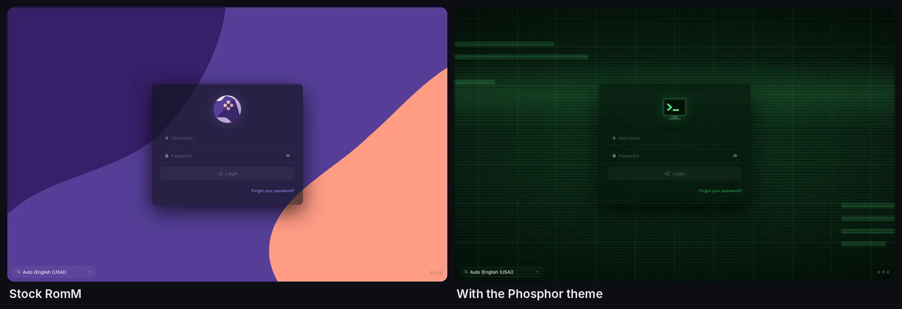
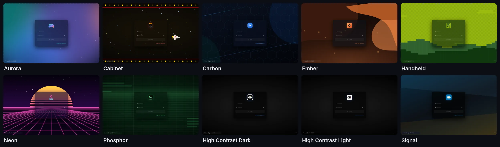
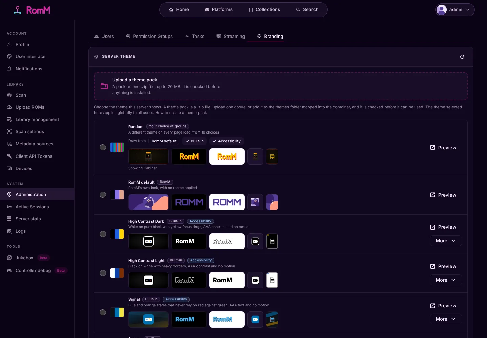
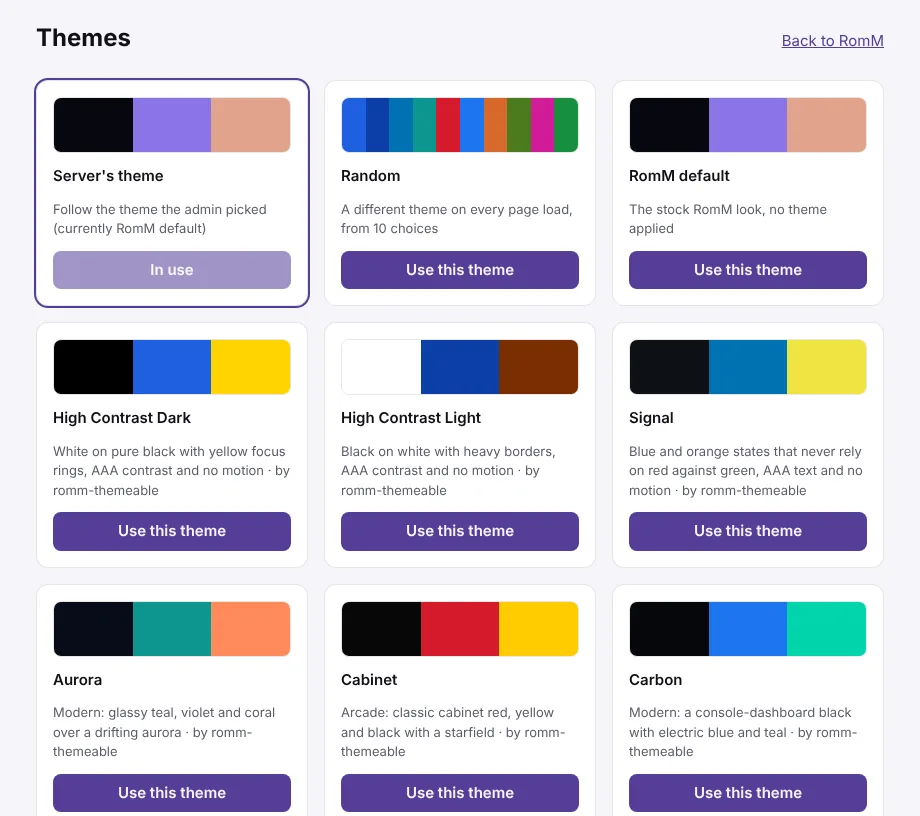

<!-- themeable:progress:start
  Progress bar slot. Nothing shows here while no version is in development.
  When development on a new version begins, add one line between this comment and the
  end marker below: the version, a ten-segment bar, the percentage of the plan's steps
  done and the current phase, linked to that version's expanded progress page. Example:

  **In development:** [`2.1.0-5.4.1` ▰▰▰▱▱▱▱▱▱▱ 30% · Phase B of D](https://claude.ai/artifact/REPLACE-WITH-PROGRESS-PAGE-ID)

  Update it when each phase ends. When the release is merged into main, delete the line
  so only these two comments remain. The rules are in themeable/GUIDELINES.md, "Progress bar".
-->
<!-- themeable:progress:end -->

# romm-themeable

romm-themeable is a fork of [RomM](https://github.com/rommapp/romm), the self-hosted ROM manager and player, that adds themes. Theme packs restyle RomM's interface (colors for light and dark mode, fonts, spacing, logos and wordmarks, login backgrounds, browser tab icons and custom CSS), and administrators choose, upload and manage them from RomM itself.

## What it sets out to do

- **Make RomM's look your own.** A server can wear one of ten built-in themes, a pack of your own, or a different pack on every page load, and each visitor can pick a theme for their own browser.
- **Stay current with RomM.** Every stable RomM release is adopted automatically, checked and rebuilt, so running romm-themeable never means running an old RomM.
- **Never leave the server worse off.** A broken or missing pack disables only itself, a change that fails to compile changes nothing, and RomM's own look is always one click or one URL away.
- **Be usable by everyone.** Three of the built-in themes are designed for accessibility: High Contrast Dark, High Contrast Light, and Signal, which never relies on red against green.

## Screenshots

**Ten built-in themes.** Each one restyles the whole interface, not just the login screen shown here. High Contrast Dark, High Contrast Light and Signal are the accessibility themes.

**Branding, in Administration.** Administrators upload a pack, choose the server's theme, set which groups Random draws from, and preview, rename or delete packs. Each row shows the pack's login background, wordmarks on dark and light, and tab icons. The page itself is wearing Neon.

**A theme for each browser.** Any visitor can open `/themeable/` to follow the server's theme, pick Random, or choose a theme for their own browser.

The screenshots are taken from the built-in packs through the module's local preview (`themeable/dev/preview.mjs`).

## How it does it

**Packs.** A theme pack is a single `.zip` holding a `theme.json` and the artwork, fonts and CSS it uses. RomM's interface is built from design tokens, so a pack mostly sets token values and names replacement files. Packs live in a folder on the host. In **Administration → Branding**, administrators choose the server's theme, upload new packs, and rename or delete them. Every upload is checked before anything is installed, because packs come from users and the web.

**Hooks, not a code fork.** Everything the project adds lives in the [`themeable/`](../themeable/) folder. RomM's own source in this repository is left unedited. At build time, new files are overlaid and a few anchored edits are applied, and the image is built on top of the stock `rommapp/romm` release image. Four hooks connect the two:

1. a loader in `index.html` that picks the theme before the page renders;
2. an nginx rule that serves a pack's artwork and tab icons in place of RomM's;
3. the Branding tab and its admin-only API;
4. a compile at start-up and on every change, which switches to a new build in one atomic step.

**Tracking upstream.** The `upstream` branch is a clean copy of RomM's release commits. An hourly workflow notices each stable RomM release and merges it into a branch. It then runs a compatibility check, unit tests, a check of the patched source, and a visual check of every theme in a real browser, and opens a pull request with the reports. If everything passes, the release is merged into `main` and the image is published; if not, the pull request stays open for a person to look at.

## Versioning

Releases are numbered `<major>.<feature>.<fix>-<RomM version>`:

| Part | Goes up by one when |
| --- | --- |
| `major` | the fork adopts a new RomM release |
| `feature` | a feature update ships |
| `fix` | a bug-fix or optimization update ships |
| `RomM version` | names the RomM release the fork is built on, as in [`themeable/ROMM_VERSION`](../themeable/ROMM_VERSION) |

When a number goes up, the numbers to its right go back to 0. For example, `2.0.5-5.4.1` is the fifth fix release on top of RomM 5.4.1, the second RomM release the fork adopted. The next feature update would be `2.1.0-5.4.1`, and adopting RomM 5.5.0 after that would make it `3.0.0-5.5.0`.

The module's own version lives in [`themeable/package.json`](../themeable/package.json). Container images are tagged with the RomM version they are built on (`ghcr.io/stealthx3/romm-themeable:5.4.1`), with the full release (`:<module>-<RomM>`, for example `:2.0.5-5.4.1`), and `:latest` for the newest.

## Getting started

The root [`docker-compose.yml`](../docker-compose.yml) deploys romm-themeable with MariaDB; fill in the values marked `REQUIRED` and run `docker compose up -d`. Switching from stock RomM only means changing the image and adding a themes folder.

- [`themeable/README.md`](../themeable/README.md): deploying, choosing and managing themes, the built-in themes, how it works, and developing the module.
- [Creating a theme pack](../themeable/docs/creating-a-theme-pack.md): a first pack, every `theme.json` key, zipping a pack, and readable colors.

## Built on RomM

romm-themeable exists because of [RomM](https://github.com/rommapp/romm) and its contributors. For RomM itself (its features, documentation and community), see the [RomM project on GitHub](https://github.com/rommapp/romm). RomM's own README, unchanged, is this repository's root [`README.md`](../README.md). Like RomM, romm-themeable is licensed under the AGPL-3.0.
