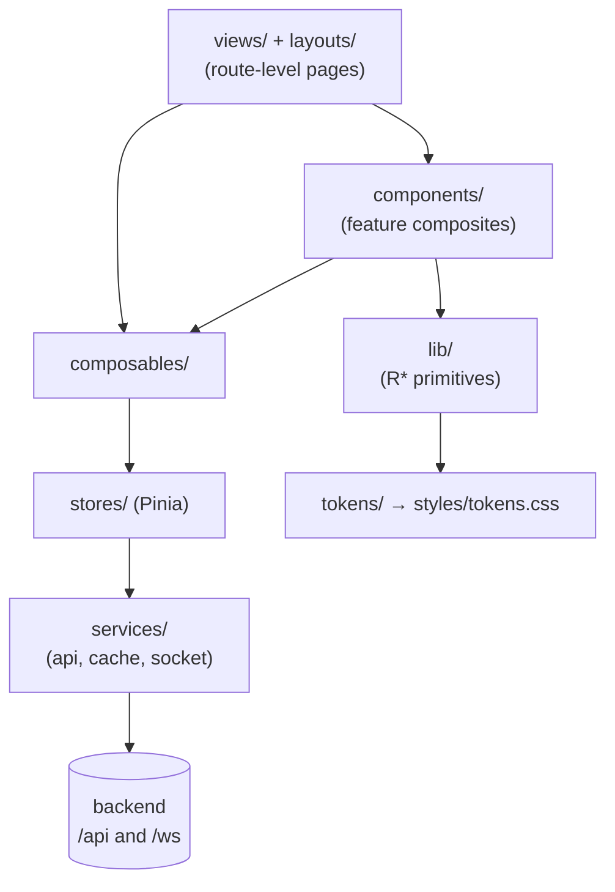

# RomM Frontend Architecture

A map of the RomM frontend (`frontend/`): a Vue 3 single-page app that talks to the backend over `/api/*` (REST) and `/ws` (Socket.IO). This document says where things live and how they fit together. The detailed rules for writing UI code live in the skills under `.claude/skills/` (`frontend-components`, `frontend-theming`, `frontend-input`, `frontend-patterns`, `frontend-i18n`), and commands are in `frontend/AGENTS.md`.

## Contents

1. [Stack](#1-stack)
2. [Layers and directories](#2-layers-and-directories)
3. [Startup](#3-startup)
4. [Routing](#4-routing)
5. [State: Pinia stores](#5-state-pinia-stores)
6. [API, caching and real time](#6-api-caching-and-real-time)
7. [Components](#7-components)
8. [Styling and theming](#8-styling-and-theming)
9. [Input and responsive layout](#9-input-and-responsive-layout)
10. [Players](#10-players)
11. [Internationalization](#11-internationalization)
12. [Types](#12-types)
13. [Build, test and tooling](#13-build-test-and-tooling)

---

## 1. Stack

| Concern   | Choice                                                                                            |
| --------- | ------------------------------------------------------------------------------------------------- |
| Framework | Vue 3 (`<script setup>`, TypeScript)                                                              |
| Build     | Vite, with Lightning CSS as the CSS transformer                                                   |
| State     | Pinia                                                                                             |
| Routing   | Vue Router (history mode, lazy route components)                                                  |
| HTTP      | Axios against `/api`, CSRF header on every request                                                |
| Real time | `socket.io-client` at `/ws/socket.io/`                                                            |
| i18n      | `vue-i18n`, one lazy-loaded JSON file per locale and namespace                                    |
| Styling   | Generated design tokens plus per-component scoped CSS. No component library, no utility framework |
| Icons     | `@mdi/font`, trimmed at build time to the icons the source uses                                   |
| Tests     | Vitest (happy-dom unit tests, plus Storybook `play()` tests in Chromium), Playwright for e2e      |

There is no Vuetify and no Tailwind. A small hand-written base reset lives in `src/styles/reset.css`.

## 2. Layers and directories

Everything lives under `frontend/src/` and is imported through the `@/` alias (`scripts/aliases.ts`, shared by the app build, Vitest and Storybook).

| Directory             | What it holds                                                                                                                                             |
| --------------------- | --------------------------------------------------------------------------------------------------------------------------------------------------------- |
| `RomM.vue`, `main.ts` | Root component (theme classes, backend status banner, `<router-view>`) and the bootstrap.                                                                 |
| `views/`              | One component per route: `Home`, `Gallery/{Platform,Collection,Search}`, `GameDetails`, `Jukebox/`, `Player/*`, `Auth/*`, `Settings` pages, pairing.      |
| `layouts/`            | `AppLayout` (main shell: nav, mini player, global composables), `AuthLayout`, `SettingsLayout`.                                                           |
| `components/`         | Feature composites, grouped by feature (`Gallery`, `GameDetails`, `Settings`, `Player`, `Scan`, `Dialogs`, ...) plus `shared/` for cross-feature ones.    |
| `lib/`                | The design-system primitives, `R*` components, in tiers: `primitives`, `structural`, `forms`, `menus`, `overlays`, `data`, `media`, plus `a11y`.          |
| `composables/`        | Reusable logic: input (`useGamepad`, `useSpatialNav`, `useGridNav`, `useInputModality`), responsive (`useBreakpoint`), gallery URL state, player, socket. |
| `stores/`             | Pinia stores (section 5).                                                                                                                                 |
| `services/`           | `api/` (one module per backend area), `cache/` (response cache), `socket.ts`, plus native-app helpers.                                                    |
| `plugins/`            | `index.ts` (Pinia, i18n and the event emitter), `router.ts` (routes and guards), `routeNames.ts`, view-transition helpers, md-editor wrapper.             |
| `router/routes.ts`    | Lazy route-component registry and the layout loaders.                                                                                                     |
| `tokens/`, `styles/`  | Design tokens in TypeScript and the generated `styles/tokens.css`, plus `fonts.css`, `global.css`, `reset.css`, `scrollbar.css`.                          |
| `locales/`            | One folder per locale, one JSON file per namespace, plus the loader and two CI check scripts.                                                             |
| `types/`              | Hand-written shared types, including the typed event map (`emitter.d.ts`).                                                                                |
| `__generated__/`      | Types generated from the backend's OpenAPI schema. Never edited by hand.                                                                                  |
| `utils/`              | Pure helpers (covers, formatting, player runtimes, storage, validation).                                                                                  |

Outside `src/`: `e2e/` (Playwright), `.storybook/`, `scripts/` (build plugins and the token generator), `eslint-plugin-romm/` (repo-specific lint rules), `public/` and `assets/` (static files and emulator payloads).

## 3. Startup

`main.ts` does the following, in order:

1. Imports the icon font and the global stylesheets (`fonts`, `global`, `reset`, `scrollbar`).
2. Creates the app and registers plugins: Pinia, i18n, and a typed `mitt` event emitter provided as `emitter`.
3. Starts syncing the per-user localStorage namespace with the signed-in user (`setStorageUser`), synchronously, so stored preferences switch user before anything renders.
4. Provides the accessible-name labels the `R*` primitives use for their own controls (`ChromeLabelsKey`).
5. Awaits, together, the initial data (`heartbeat`, current user, config) and the locale messages. The router waits for both because the first guard resolves the page title.
6. Installs the router and mounts `#app`.

Stale chunks after a redeploy are handled once, by a guarded reload on `vite:preloadError` and on router import errors.

`RomM.vue` puts `r-app` and `r-dark` or `r-light` on `<html>`, driven by the `settings.theme` preference (`auto`, `dark`, `light`) and `prefers-color-scheme`. The classes live on `<html>` so overlays that teleport to `<body>` resolve the same tokens.

## 4. Routing

Routes are declared in `plugins/router.ts`, named in `plugins/routeNames.ts` (`ROUTES`), and bound to lazy components in `router/routes.ts`. Three layouts:

- `auth`: `/setup`, `/login`, `/register`, `/reset-password`.
- `main` (`AppLayout`): home, `/search`, `/music/:mode?`, `/platform/:platform`, the three collection kinds (`/collection/:collection`, `/collection/virtual/:collection`, `/collection/smart/:collection`), `/platforms`, `/collections`, and the ROM routes: `/rom/:rom` plus one player route per engine (`ejs`, `jsdos`, `pico8`, `easyrpg`, `ruffle`, `stream`) and `/stream/desktop`.
- `settings` (`SettingsLayout`, nested in `main`, the sidebar and content-panel shell): `/scan`, `/upload`, `/activity`, `/notifications`, `/user/:user`, `/controller-debug`, and the settings pages `user-interface`, `library-management`, `scan-settings`, `conversion-settings`, `metadata-sources`, `client-api-tokens`, `devices`, `administration`, `server-stats`, `logs`.
- `/pair` and `/pair/device` for device pairing.

The global `beforeEach` guard:

1. If the backend is unreachable, lets navigation through on cached state (a banner explains it and re-routes once the backend answers).
2. Sends everyone to `/setup` while the setup wizard is pending, and away from it afterwards.
3. Sends unauthenticated users to `/login?next=...` unless the route is auth-exempt (`login`, `setup`, `reset-password`, `register`, `pair`).
4. Checks `ROUTE_SCOPES` (for example `scan` needs `platforms.write`, `administration` needs `users.write`) against the user's OAuth scopes and sends a user without them to the 404 view.
5. Applies the route title (`meta.title` is a locale key; views that own their title call `usePageTitle`).

`beforeResolve` runs a View Transition for real view changes (not for query-only changes). Scroll and focus restoration across navigations live in `stores/scrollRestoration` and `stores/focusRestoration`.

## 5. State: Pinia stores

| Area               | Stores                                                                                                                        |
| ------------------ | ----------------------------------------------------------------------------------------------------------------------------- |
| Session and server | `auth`, `users`, `heartbeat` (server state, setup and feature flags), `config`, `permissions`, `permissionGroups`, `language` |
| Library            | `platforms`, `collections`, `galleryRoms`, `galleryFilter`, `gallerySelection`, `roms`, `formatConversions`                   |
| Playing            | `playing` (a game is running), `streaming`, `soundtrackPlayer`, `musicFavorites`, `native`                                    |
| Background work    | `scanning`, `upload`, `tasks`, `activity`                                                                                     |
| Notifications      | `notifications` (snackbars), `notificationInbox`                                                                              |
| Navigation         | `navigation` (drawers, collapsed main bar), `scrollRestoration`, `focusRestoration`                                           |

Two worth knowing:

- **`galleryRoms`** is the gallery list. It is windowed: a sparse `byPosition` map filled by random-access window fetches as rows enter the virtualiser's viewport, plus a total count and a per-letter offset table from the backend. The gallery context (current platform or collection) lives here. `galleryFilter` holds filters; `gallerySelection` holds multi-select.
- **`roms`** holds what the gallery doesn't: a small LRU cache of detailed ROM records (`detailedRoms`, read through `getDetailedRom` and `useRouteRom`), `currentRom`, and Home's recent and continue-playing rows.

Logout calls `reset()` on every store that defines one. Per-user preferences are not in Pinia: they are `useUserLocalStorage` keys, namespaced by user id (an ESLint rule forbids unscoped `localStorage` access).

## 6. API, caching and real time

**REST.** `services/api/index.ts` creates the Axios instance (`baseURL: "/api"`, repeated-key array params, 120 s timeout) and interceptors: the `x-csrftoken` header from the `romm_csrftoken` cookie, in-flight tracking that emits a `network-quiesced` DOM event, reachability events (`backend-online`, `backend-offline`, `backend-suspect`) that `useServerConnection` turns into the status banner, a CSRF-token refetch when the backend rejects the token, and 401 handling that clears the session cookie and sends the user to the login page. Each backend area has its own module (`rom.ts`, `platform.ts`, `collection.ts`, `save.ts`, `state.ts`, `sync.ts`, ...) returning typed responses. Large uploads go through chunked upload helpers in `rom.ts`.

**Types.** Request and response shapes come from `__generated__/`, regenerated from the backend OpenAPI schema (`npm run generate`). The backend is the source of truth for the API contract.

**Response cache.** `services/cache/` is an optional stale-while-revalidate cache on top of the browser Cache API, behind the user setting `settings.enableExperimentalCache`. Home's recent and continue-playing requests use it. The `roms` store's add and remove helpers for those rows clear the matching cached responses; other writes, such as metadata edits through `applyRomWrite`, do not.

**Socket.IO.** `services/socket.ts` exports one client (`autoConnect: false`). It connects on demand (scanning, uploads and activity presence call `socket.connect()` when they need it), and `AppLayout` reconnects it on mount. Views and composables subscribe through `useSocketEvent` or `socket.on` and emit directly. Events in use:

- scanning: emit `scan` and `scan:stop`; receive `scan:scanning_platform`, `scan:scanning_rom`, `scan:update_stats`, `scan:done`, `scan:done_ko` (consumed by `useScanLifecycle`, which batches per-ROM updates);
- presence and play activity: `activity:heartbeat`, `activity:start`, `activity:stop`, and `activity:update` / `activity:refresh` / `activity:clear`;
- `permissions:changed`: `installPermissionsHydration()` (in `useCan`, called from each layout) re-fetches `/permissions/me` into the permissions store, and the activity store re-lists the sessions the user may see. Route-guard scopes (`auth.user.oauth_scopes`) come with the user record, not from this event.

`useSocketTransportHealth` and `useServerConnection` feed the backend-status banner.

**Cross-store consistency.** The same ROM can sit in the gallery window map, Home's rows and the detail cache. `useRomSync` is the single place that writes a changed ROM into all of them, so callers don't update each store by hand.

## 7. Components

Three tiers, each importing only from the tiers below it:

1. **`lib/` primitives** (`RBtn`, `RTextField`, `RSelect`, `RDialog`, `RTable`, ...). Presentation plus accessible behaviour only: no stores, no API calls. Each has a Storybook story, and an interactive one has a `play()` test that runs axe.
2. **`components/shared/` composites**: reusable combinations of primitives that know about app concepts (a platform picker, a language selector).
3. **Feature composites** under `components/<feature>/` and the `views/` that compose them. These own data fetching and store access.

Conventions that matter day to day: the `lib/` barrel (`@/lib`) exports the primitives; dialogs mount once, in `GlobalDialogs` inside `AppLayout`, and open through emitter events (`emitter.emit("showXDialog", ...)`, typed in `types/emitter.d.ts`); overlays push themselves on the escape stack (`lib/overlays/RDialog/escapeStack`). See the `frontend-components` and `frontend-patterns` skills for the SFC structure, import order, loading and error patterns, and the "no duplicated coverage between Vitest and Storybook" testing rule.

## 8. Styling and theming

- **Tokens** are defined once in `src/tokens/index.ts` and compiled to `src/styles/tokens.css` by `scripts/build-tokens.ts` (`npm run build:tokens`, run automatically before `dev` and `build`). Components read `var(--r-...)`; hex colour literals are lint errors (`romm/no-color-literal`).
- **Themes** are the `r-dark` and `r-light` classes on `<html>` (section 3). Each themed colour is one `light-dark(<light>, <dark>)` declaration resolved by `color-scheme`: `html.r-app` sets `light dark` (the OS preference), and the two classes pin it. The generator pairs the palettes by name and fails the build if a token exists in only one.
- **Stylesheets** loaded globally: `fonts.css` (self-hosted fonts), `global.css` (the `.r-app` base, backdrop layers), `reset.css` (the base reset, in `@layer base`, plus the full-height app shell), `scrollbar.css`.
- **Component styles** are scoped SFC `<style>` blocks. Layout switches use the `html[data-bp~="..."]` attribute selectors rather than `@media` (section 9).
- **Boot splash.** `index.html` carries a tiny inline style so the first paint matches the theme before the app mounts.
- **Icons.** `@mdi/font` is imported once in `main.ts`; the `trimMdiIcons` build plugin drops every icon the source never names.

The `frontend-theming` skill covers the token vocabulary, state colours and the zero-literal policy.

## 9. Input and responsive layout

Every interactive surface works with mouse, touch, keyboard and gamepad. There is one model: the gamepad is translated into keyboard events, so components handle keys and a pad works for free.

- `useGamepad` polls the pad and emits synthetic arrow, Escape and click events. `useSpatialNav` moves focus to the nearest control for arrows nobody claimed. `useGridNav` adds per-view 2D grid behaviour. `useGlobalHotkeys` handles `/`, `?` and the `g h` / `g p` / `g c` sequences, and ignores keys a widget already claimed with `preventDefault`.
- **The claim rule:** a handler that uses a key calls `preventDefault`; one that doesn't leaves the key alone. Escape closes the topmost entry on the escape stack, and an unclaimed pad B navigates back.
- `useInputModality` sets `data-input="mouse|touch|key|pad"` on `<html>`; focus rings show only for `key` and `pad`.
- **Breakpoints** come from one place, `useBreakpoint`, using the Material thresholds (`xs` under 600 px up to `xl` from 1920 px). `installBreakpointAttribute()` mirrors the active set onto `<html data-bp="...">`, and CSS selects on it. Conditional mounting uses the composable's refs.

While a game runs (`playing` store), the pad and keyboard belong to the emulator and the above is suspended. The `frontend-input` skill has the details.

## 10. Players

Each engine has a view under `views/Player/` and its own route:

| Route suffix | Engine / view                           | Notes                                                                                                                                                      |
| ------------ | --------------------------------------- | ---------------------------------------------------------------------------------------------------------------------------------------------------------- |
| `ejs`        | EmulatorJS (`EmulatorJS.vue`)           | Most consoles, and plain DOS through the `dosbox_pure` core. Cores are served from `frontend/assets/emulatorjs` under `/assets/emulatorjs`.                |
| `jsdos`      | js-dos (`JsDos.vue`)                    | Windows 3.x and 9x (`win3x`, `win9x`), and only `.jsdos` bundles.                                                                                          |
| `pico8`      | PICO-8 (`Pico8.vue`)                    | Own runtime and audio worklet under `utils/`.                                                                                                              |
| `easyrpg`    | EasyRPG (`EasyRpg.vue`)                 | Game files are fetched per ROM; nginx (and the Vite dev proxy) rewrite `/assets/easyrpg/games/<rom id>-<user id>/...` to `/api/roms/<rom id>/easyrpg/...`. |
| `ruffle`     | Ruffle (`Ruffle.vue`)                   | Flash.                                                                                                                                                     |
| `stream`     | Streaming (`Stream.vue`, `Desktop.vue`) | Remote play.                                                                                                                                               |

`useCanPlay` decides whether a ROM is playable in this browser (admin toggles, platform support, a file to boot, a streaming container, or a local emulator in the desktop shell); `usePlatformPlayable` answers the same for a whole platform. `ejs` and `jsdos` run cross-origin isolated (COOP and COEP headers, set by nginx in production and by `scripts/playerIsolationHeaders.ts` in dev and preview; a test fails if the two drift). Headers apply only to a document load, so a route change into a player is not enough when the engine needs `SharedArrayBuffer` (js-dos always does; EmulatorJS only for threaded cores): the view relaunches into an isolated document with `useIsolatedLaunch` (the pre-play selection crosses as a per-tab intent). On the way out, `usePlayerExit` replaces the document instead of navigating, because isolation outlives SPA navigations and blocks the third-party images the rest of the app embeds. Save states, saves and play sessions go through `services/api/{state,save,play-session}.ts`, with `useDeviceSaveSync` and `usePendingAssetSync` reconciling device saves.

EmulatorJS is a snapshot client (`utils/saveSync/snapshotSession.ts`). `sessionTarget` picks the channel: the booted snapshot's, else the booted save's, else the one the slot names (`autosave` files into `default`), created by the first push. Every SRAM write and state capture pushes onto the snapshot the last push made. A session that booted an older snapshot rewinds the channel on its first push, and once another device moves the channel on, the server keeps the session's pushes as a branch. A push the server can't take yet waits in `pendingAssetStore` and replays as recorded. "Play from here" in the snapshot drawer opens `/rom/:id/ejs?snapshot=<id>[&state=<id>]`, and `snapshotId` rides the launch intent across the isolation reload.

## 11. Internationalization

All user-visible text is a message key, written `t("namespace.key")`. Locale files are `src/locales/<locale>/<namespace>.json` (namespaces: `activity`, `audit`, `collection`, `common`, `emptyStates`, `gallery`, `home`, `login`, `logs`, `notifications`, `patcher`, `platform`, `play`, `recommendations`, `rom`, `scan`, `settings`, `setup`). `en_US` is the source and the fallback; every key must exist in every locale in the same change, and keys stay sorted. `src/locales/index.ts` loads one locale's namespaces lazily with `import.meta.glob`, and the browser language picks the default (exact region first, then language). Two CI scripts enforce parity and ordering: `check_i18n_locales.py` and `check_i18n_sorted.py`. See the `frontend-i18n` skill.

## 12. Types

- `__generated__/`: OpenAPI-derived models. Regenerate, never edit.
- Store files re-export the domain aliases the app uses (`SimpleRom`, `DetailedRom` in `stores/roms.ts`).
- `types/`: shared hand-written types, the typed emitter event map, and ambient declarations for the player libraries.

## 13. Build, test and tooling

**Scripts** (`frontend/package.json`): `dev`, `build`, `preview`, `typecheck` (`vue-tsc --build`, which covers the app, the Node tooling and the e2e suite), `generate`, `build:tokens`, `test`, `storybook`, `storybook:test`, `test:e2e`.

**Vite** (`vite.config.js`): the Vue plugin, PWA, and project plugins from `scripts/` (`precompress` for static assets, `playerIsolationHeaders`, `previewAssets`, `platformIconManifest`, `trimMdiIcons`). The dev server proxies `/api`, `/ws`, `/netplay` and `/openapi.json` to the backend (`DEV_PORT` or `DEV_PROXY_TARGET`).

**Tests** (`vitest.config.ts`, three projects):

- `app`: unit and component tests (`src/**/*.test.ts`).
- `storybook`: every story in headless Chromium, with `play()` interactions and an axe pass (layout enabled, so colour contrast is checked) on each.
- `eslint-plugin-romm`: the custom lint rules (`no-color-literal`, `no-layout-media-query`, `no-safe-area-env`, `no-unscoped-local-storage`).

`e2e/` holds the Playwright suite (smoke loads, auth, ROM actions, an axe check per page); see `e2e/README.md`.

**Lint and format** run through Trunk (`trunk fmt && trunk check`), which wraps ESLint, Prettier and the rest. CI (`.github/workflows/`) runs typecheck, tests, build, the boot check, e2e, i18n parity, and the API-types check that fails when the committed `__generated__/` drifts from the backend schema.
