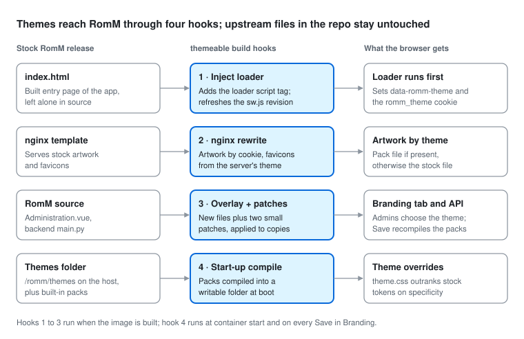

# RomM Themeable

A theme and artwork module for [RomM](https://github.com/rommapp/romm) that lives beside the upstream code instead of inside it. Theme packs change the v2 UI's colors, fonts, spacing, corner radius, motion, logos, backgrounds, placeholder art, platform icons and favicons, and can add their own CSS. Packs live in a folder on the host; admins pick the server's theme in **Administration → Branding**. The module is layered onto each stock RomM release, so a new upstream release needs a version bump and a read of the release reports, not a code merge.

Everything the module owns sits in this `themeable/` folder, plus the `themeable*` workflow files in `.github/workflows/` and a short banner at the top of the root `README.md`, and the root `docker-compose.yml`, which on this branch is the production deployment instead of upstream's development stack.

**Status:** Phases 0 to 3, 6 and 8 are built and tested; Phase 4 (theme editor) is planned. See [Development plan](#development-plan).

## Quick start

Run the published image (or build your own, below) with a themes folder mapped from the host. The root [`docker-compose.yml`](../docker-compose.yml) is ready for production: pinned image and MariaDB versions, health checks for both containers, log rotation, and every value you must fill in marked `REQUIRED`. Its image tag follows `ROMM_VERSION`, and the upstream release workflow bumps both together. The parts that differ from stock RomM are:

```yaml
services:
  romm:
    image: ghcr.io/stealthx3/romm-themeable:5.4.0 # or :latest
    volumes:
      - /path/to/themes:/romm/themes # theme packs, one folder each, plus themeable.json
```

**First start:** replace every `/path/to/...` with a folder on the host, fill in every value marked `REQUIRED` (`openssl rand -hex 32` makes a good secret), run `docker compose up -d` from the clone's root and open `http://<host>/` to create the admin account. On this branch the root `docker-compose.yml` replaces upstream's development stack, which stays on `master` with `DEVELOPER_SETUP.md`. To build the image on the machine instead of pulling it, uncomment the `build:` block in the file and run `docker compose up -d --build`.

**Upgrading:** back up the database, set the image tag to the new RomM release (images are tagged with the release they are built from), then run `docker compose pull && docker compose up -d`.

Then:

1. Put theme packs in `/path/to/themes`, one folder per pack ([how to write one](docs/creating-a-theme-pack.md)).
2. In RomM, open **Administration → Branding**, choose a theme and click **Save changes**. Saving stores the choice in `/path/to/themes/themeable.json` and recompiles every pack from the folder, so edits made on the host apply when you save. The refresh button in the tab rescans the folder without changing the selection.
3. Everyone who hasn't picked their own theme gets the server's theme on their next page load.

**Built-in themes** ship in the image, ready to pick in Branding without adding anything to the themes folder:

| Theme | Style | Look |
| --- | --- | --- |
| `phosphor` | Retro | Green-screen CRT terminal: monospace headings, scanlines, a monitor icon |
| `handheld` | Retro | The four shades of a pocket LCD, with pixel-art icon, wordmark and landscape |
| `neon` | Arcade | Synthwave magenta and cyan, a neon joystick and a sunset over a scrolling grid |
| `cabinet` | Arcade | Classic cabinet red, yellow and black, a cabinet icon and a twinkling starfield |
| `carbon` | Modern | Console-dashboard black with electric blue and teal, a play-badge icon |
| `aurora` | Modern | Glassy teal, violet and coral over a drifting aurora, a gamepad icon |
| `ember` | Warm | Charcoal and orange; the smallest complete example to copy |

Each sets colors for both modes and the v1 interface, the logo, wordmark, loading logo, login background (animated, with a still version for Firefox) and favicons, and keeps text and buttons at readable contrast. Copy one into the themes folder under a new id to use it as a starting point.

**Getting back to RomM's own look** always works:

- Choose **RomM default** (always the first entry) in Branding and save.
- Delete or empty `themeable.json` in the themes folder and restart the container.
- `?romm-theme=none` on any RomM URL forces it in that browser, even if the Branding tab itself fails to load.
- A missing, unreadable or broken theme falls back to RomM's look automatically, and a pack that fails to compile never stops RomM from starting.

**Per-browser choice:** `/themeable/` lists the installed themes and lets each browser pick its own, or follow the server's theme. `?romm-theme=<id>` switches a browser to a theme, `?romm-theme=default` returns it to the server's theme, and `?romm-theme-preview=<id>` shows a theme for one page view without saving anything (the Branding tab's **Preview** buttons use it).

**Building the image yourself** (build context is the repository root):

```bash
docker build -f themeable/docker/Dockerfile --build-arg ROMM_VERSION=5.4.0 -t romm-themeable:5.4.0 .
```

**Previewing without Docker:** build the frontend with the module applied, then serve it through the patched nginx config (needs `nginx` on your PATH). Without a backend the stub API is enough for the login screen and the theme picker; pass `--api-port` to proxy a running RomM backend, started with the `THEMEABLE_*` variables the preview prints so Branding can recompile. Other options: `--packs-folder <dir>`, `--default <id>|none`, `--port` (8099), `--dist <frontend build>`. Ctrl-C stops everything.

```bash
mkdir -p /tmp/rt && cp -r frontend themeable /tmp/rt/   # a throwaway copy; the checkout stays untouched
node /tmp/rt/themeable/scripts/apply-source.mjs --root /tmp/rt --only frontend --force
(cd /tmp/rt/frontend && npm ci && npm run build)
node themeable/dev/preview.mjs --dist /tmp/rt/frontend/dist --packs-folder ./my-themes --default ember
# http://localhost:8099/login and /themeable/; Branding needs a backend (--api-port)
```

## Writing a pack

See **[Creating a theme pack](docs/creating-a-theme-pack.md)**: folder layout, every `theme.json` key, colors and fonts, artwork, favicons, custom CSS, previewing and installing. [`packs/ember`](packs/ember) is a full example and [`schema/theme.schema.json`](schema/theme.schema.json) gives editors autocompletion.

## How it works



The Dockerfile starts `FROM rommapp/romm:<tag>` and changes these things:

1. **Loader in `index.html`.** One `<script src="/themeable/loader.js">` at the end of `<head>`. Before the app renders, it picks the theme (preview URL, then this browser's own choice, then the server's theme), sets `data-romm-theme` on `<html>`, adds the pack's stylesheet and sets the `romm_theme` cookie that tells nginx which artwork to serve. RomM's service worker precaches `index.html` by MD5 revision, so the hook also updates that revision in `sw.js`; otherwise browsers that installed the stock worker would keep the stock page.
2. **nginx config.** In the `/assets` block, `try_files /themes/$themeable_theme$uri $uri ...`, where `$themeable_theme` comes from the cookie through a `map` that only accepts valid pack ids; a pack's file wins if it has one, otherwise the stock file is served, sent `no-cache` with `Vary: Cookie`. A second location serves favicons from the server's theme when it ships them. Both are an anchored rewrite (`lib/nginx.mjs`) that fails the build if the template changes shape.
3. **Branding in RomM itself.** New files in `overlay/` (the Branding tab, its API client and English text, and the backend router) are copied into RomM's source, and the small edits in `patches/` register the tab in `Administration.vue` and the router in the backend's `main.py`. The image build rebuilds the frontend with them and patches the release image's own backend. Upstream files in this repository are never edited, so releases merge cleanly; a patch that stops applying fails the build and the release checks with a clear message.
4. **Start-up compile.** The image's entrypoint (`docker/entrypoint.sh`) runs `scripts/runtime.mjs` before RomM's own entrypoint. It compiles the built-in packs and the packs in `/romm/themes` into `/tmp/themeable` (writable whatever user the container runs as; nginx reaches it through links in the web root), switching to each new build in one step. Saving in Branding runs the same script through the backend.

Each compiled `theme.css` scopes its rules under `:root[data-romm-theme="<id>"]`, which outranks upstream's token rules whatever order the stylesheets load in. Vite inlines small CSS artwork, such as the login background, into the app bundle as `data:` URIs, which never reach nginx; the catalog records every upstream CSS rule that uses an `/assets/` file, and the compiler emits a matching rule pointing at the pack's copy.

## Commands

Run in `themeable/` (Node 20 or later; no dependencies to install):

| Command | Does |
| --- | --- |
| `npm test` | Unit tests, including both patches and the nginx rewrite against the real upstream files. |
| `npm run build -- [--packs packs] [--catalog catalog] [--out dist] [--default <id>\|none]` | Validates and compiles the built-in packs into `dist/`; fails on any invalid pack. |
| `npm run catalog` | Regenerates `catalog/` from this repo's `frontend/`; `--tokens <css file\|dir> --assets-list <file> --out <dir>` reads a built image instead. |
| `npm run check-upstream -- [--upstream <repo root>] [--report <file.md>]` | Compares the committed catalog with the current tree, checks hook anchors, patches, overlay collisions and packs; exits 1 on breakage. |
| `npm run example -- [--check]` | Regenerates [`docs/theme.example.json`](docs/theme.example.json), a pack with every option set, from the catalog and upstream's v1 palette; `--check` fails if it is out of date. The release workflow runs it after the catalog. |
| `npm run preview` | Local preview described above. |
| `npm run visual` | Visual check: loads the login screen for stock and every built-in pack in both modes and fails if a pack's tokens, artwork or inlined artwork didn't apply, or if it looks the same as stock. Needs a frontend build, nginx and Playwright's Chromium (set `CHROMIUM_PATH` to use another). |
| `node scripts/apply-source.mjs --root <copy> [--only frontend\|backend] [--no-tests]` | Applies `overlay/` and `patches/` to a copy of RomM's source. Refuses the repository checkout itself unless `--force` (CI uses that on its throwaway checkout). |
| `node scripts/runtime.mjs [--select <id>\|none]` | What the container runs at start-up and on save; prints its status as JSON. Reads `THEMEABLE_PACKS_PATH` (default `/romm/themes`) and `THEMEABLE_RUNTIME_DIR` (default `/tmp/themeable`). |
| `node scripts/apply-hooks.mjs --webroot <dir> --nginx <template> --out <dir> [--root-overlay <dir>] [--default <id>\|none]` | Writes the hooked `index.html` (loader tag), nginx template (`/assets` reads `/themes/<theme>/` first) and `sw.js` (precache revisions); the Dockerfile runs it. |
| `node scripts/verify-image.mjs --css <image /assets dir> [--packs packs]` | Checks every pack token against a built image's CSS. |

`npm run visual` takes `--out <dir>` and `--port` (8199), uses Playwright from `frontend/node_modules`, and honours `CHROMIUM_PATH`.

## Automation

Three workflows keep the module current without anyone touching it, leaving a PR trail to audit:

| Workflow | Runs | Does |
| --- | --- | --- |
| `themeable` | Every push and PR to `themeable` | Unit tests and compatibility check, then the source and visual checks, then (on push) builds the image, smoke-tests it (start-up compile, theme links, patched files, nginx config) and publishes `ghcr.io/stealthx3/romm-themeable:<ROMM_VERSION>` and `:latest`. |
| `themeable upstream release` | Hourly, or by hand with a tag | When RomM publishes a new stable release: moves `master` forward to that release's commit, merges the tag into a `themeable-upstream/<tag>` branch, runs the compatibility check, refreshes the catalog, bumps `ROMM_VERSION`, runs the visual check against the new release's frontend, and opens a PR with both reports. If everything passed, it merges the PR, which publishes the new image. Otherwise the PR stays open, titled "needs attention". |
| `themeable visual check` | Called by the other two | Builds the frontend (with the overlay and patches) using upstream's own setup action and runs `npm run visual`; screenshots are kept as the `themeable-visual` artifact for 90 days. |
| `themeable source check` | Called by the other two | Applies the overlay and patches, lints and type-checks the patched frontend, and runs the Branding API tests against MariaDB with the patched backend. |

`master` is never synced on its own schedule: it moves only when a new stable release is posted, so it always equals the latest release commit (unreleased upstream commits, for example from a past **Sync fork**, are reset away) (prereleases and manual runs with other tags leave it alone). Don't use GitHub's **Sync fork** button, which would move it to upstream's latest commit. A merge conflict or a missing secret opens an issue instead. Set the repository variable `THEMEABLE_AUTO_MERGE` to `false` to review every adoption before it merges.

## Per-release maintenance

The `themeable upstream release` workflow does this within an hour of each release. By hand:

1. Merge the new upstream tag into `themeable`. The module only adds files, so the only likely conflicts are the README banner and the root `docker-compose.yml`; for the latter, keep the themeable version (the workflow does this automatically).
2. `npm run check-upstream` reports added, removed and renamed tokens and artwork, and any pack or hook that would break.
3. Add renames to `catalog/token-aliases.json` (`{"--r-old": "--r-new"}`); packs using the old name keep compiling, with a warning.
4. `npm run catalog`, then set `ROMM_VERSION` to the tag and push. The `themeable` workflow builds and publishes `ghcr.io/stealthx3/romm-themeable:<tag>`.

## Development plan

The module ships as files added on top of a stock RomM release, never as edits to upstream source, so it can be rebuilt for every release.

| Phase | Deliverable | Estimate | Status |
| --- | --- | --- | --- |
| 0. Repo and pipeline | `master` holds only upstream release commits; module on `themeable`; CI builds `ghcr.io/stealthx3/romm-themeable:<tag>` | 1 to 2 days | Done |
| 1. Packs and static overlay | Pack schema, validator, compiler, example pack, derived Dockerfile | 3 to 4 days | Done |
| 2. Runtime switching | Loader, cookie-driven nginx artwork, picker page, service worker revision fix, inlined-artwork rewrite | 3 to 5 days | Done, except saving the choice to the user's account |
| 3. Catalog and checker | Token, asset and CSS-reference catalog; release diff report; token aliases | 2 to 3 days | Done |
| 4. Theme editor | Standalone page at `/themeable/studio/`: token editor by group with contrast checks, live preview in an iframe, artwork slots with upload, fonts, zip export and import | 1.5 to 2 weeks | Not started; the loader's `preview()` and `postMessage` channel are in place for it |
| 5. Save service (optional) | Superseded by Phase 8, which manages packs from a host folder through RomM's own backend | | Superseded |
| 6. Release automation | Hourly upstream release check and adoption PR with compatibility and visual checks; auto-merge when both pass; image published on merge | 2 to 3 days | Done for logged-out screens; screens behind login need a seeded backend in CI |
| 8. Branding | Packs on a mapped host folder, managed from a new **Administration → Branding** tab; see [Phase 8](#phase-8-branding) | 2 to 2.5 weeks | Done |

### Phase 8: Branding

Theme packs live in a host folder mapped into the container (for example `/path/to/themes:/romm/themes`). Admins pick the server's theme in **Administration → Branding** and click **Save changes**, which stores the choice and recompiles the packs from the folder. No image rebuild is needed to add or change a theme.

**Branding tab:**

- A radio-button list of themes. **RomM default** (the stock look, no pack) is always the first option.
- Each entry shows the theme's name, color swatch, source (built-in or host folder) and status: valid, or the validation errors that keep it from being used. A **Preview** link opens RomM with that theme in a new tab.
- At most 10 themes per page; longer lists get page controls inside the tab.
- **Save changes** at the end of the list saves the selection and reloads the packs, then shows the result.
- Visible to admins only, in the v2 interface. Text is English only for now; untranslated strings fall back to English.

**Always able to revert to RomM's default look:**

- The selection is saved in `themeable.json` in the themes folder, so it survives rebuilds and can be edited from the host.
- If `themeable.json` is missing or unreadable, or the selected theme has been removed or no longer compiles, RomM uses its default look and the Branding tab says why.
- `?romm-theme=none` on any RomM URL forces the default look in that browser, even if the Branding tab itself fails to load.
- A pack that fails to compile is skipped; it never stops RomM from starting.

**How it fits the module's independence from upstream:**

| Part | Where it lives | Upstream files touched |
| --- | --- | --- |
| Runtime compiler and startup hook | `themeable/scripts/`, an entrypoint wrapper in the image | None |
| Backend API (`/api/themeable/...`, admin only) | New router in `themeable/overlay/backend/` | One small patch registering the router |
| Branding tab | New component in `themeable/overlay/frontend/` | One small patch adding the tab to `Administration.vue` |

New files are copied into RomM's source at build time from `themeable/overlay/`. Edits to existing files are small patches in `themeable/patches/`. The image build applies both and rebuilds the frontend, so the upstream files on this branch stay untouched and releases keep merging cleanly. If a release changes a patched spot, the patch stops applying, the build fails with a clear message, and the adoption PR stays open as "needs attention".

| Step | Deliverable | Estimate | Status |
| --- | --- | --- | --- |
| 8a | Packs compiled from the mapped folder at startup and on save, into a writable folder inside the container; works as a non-root user | 2 to 3 days | Done |
| 8b | Backend API: list packs with status, save the selection and reload | 2 days | Done |
| 8c | Branding tab: radio list, RomM default first, 10 per page, Save changes | 3 to 4 days | Done |
| 8d | Overlay and patch system, frontend rebuild in the image, release pipeline step | 3 days | Done |
| 8e | Theme-pack guide, deployment example with the volume, verification | 1 to 2 days | Done |

**Next steps:**

- Build the theme editor (Phase 4) on top of Branding: edit a pack's tokens with a live preview and save it into the themes folder.
- Optionally save a user's own theme choice to their RomM account (`user.ui_settings`) so it follows them across devices. The backend replaces that whole object on each write, so the loader must read, merge and send it all back.
- Translate the Branding tab's text. It is English only today because adding keys to every locale file would add conflict-prone edits to upstream files; untranslated text falls back to English.

## What the RomM codebase gives the module

| Area | Upstream | Consequence |
| --- | --- | --- |
| Two UIs | v1 (Vuetify) is frozen and slated for deletion; v2 (`frontend/src/v2/`) is the active rewrite | Target v2; v1 gets a palette only |
| Design tokens | `src/v2/tokens/index.ts` generates `tokens.css`: 173 `--r-*` variables in source, 182 in the built CSS | Overriding them re-skins v2 |
| Theme classes | `RomM.vue` puts `.r-v2` plus `.r-v2-dark` or `.r-v2-light` on `<html>` | Pack CSS scopes on `<html>` |
| Color discipline | No hex or `rgba()` literals in v2 components, enforced by lint | Nearly every color is a token |
| Artwork | `frontend/assets` is copied as-is to `/var/www/html/assets` with stable names | Same-URL replacement through nginx |
| Per-user settings | `user.ui_settings` is free-form JSON | Room to store a theme choice |

## Risks and limitations

| Risk | Effect | Mitigation |
| --- | --- | --- |
| v2 changes fast | Tokens get added and renamed | Catalog diff, aliases, compatibility check in CI |
| `extraCss` targets component classes | Breaks across releases | Labelled unsupported; screenshots in Phase 6 |
| JS-baked colors (`colorCoverArt`, `colorCanvas`) | Generated placeholder covers and the player canvas ignore themes | Accept, or carry a small patch to `v2/utils/covers.ts` |
| Local token overrides | `.r-v2-bg__layer--a` redefines some surface tokens over cover art | Override in `extraCss` if needed |
| Build-time platform-icon list | Packs can replace icons but not add platforms upstream lacks | Replace existing icons only |
| Theme choice is per browser | A visitor's own pick doesn't follow them to other devices | The server's theme from Branding covers everyone who hasn't picked; `ui_settings` sync is a next step |
| Patched RomM files | A release that reshapes `Administration.vue` or the router list in `main.py` stops a patch from applying | The compatibility check, the source check and the image build all fail with the patch's name; the adoption PR stays open and the daily audit proposes a fix |
| Frontend rebuilt from this branch | The image's interface comes from this branch's copy of RomM's source rather than upstream's published build | Each release is merged in before building; the compatibility check compares the two |
| v1 UI | Palette only | v1 is scheduled for deletion upstream |

## Repository setup

One-time settings for unattended running:

1. **Default branch:** set it to `themeable` (Settings, General). Scheduled workflows only run from the default branch, and the landing page then shows this module.
2. **Bot token:** create a fine-grained personal access token limited to this repository with Contents, Pull requests and Workflows set to read and write, and save it as the Actions secret `THEMEABLE_BOT_TOKEN`. GitHub's built-in token can't push upstream's workflow-file changes, which most releases include. Expect to renew it when it expires; the workflow opens an issue when it's missing.
3. **Upstream's scheduled workflows:** once `themeable` is the default branch, upstream's `build.yml`, `image-scan.yml`, `trunk-check-all.yml`, `trunk-upgrade.yml` and `update-hltb-api-url.yml` start running on their schedules and fail or open PRs without upstream's secrets. Disable them under Actions; disabling doesn't touch the files, so upstream merges stay clean.

GitHub also pauses scheduled workflows after 60 days without repository activity; each adopted release counts as activity.
- RomM is AGPL-3.0. Published images must keep their source available, which this public fork does.
